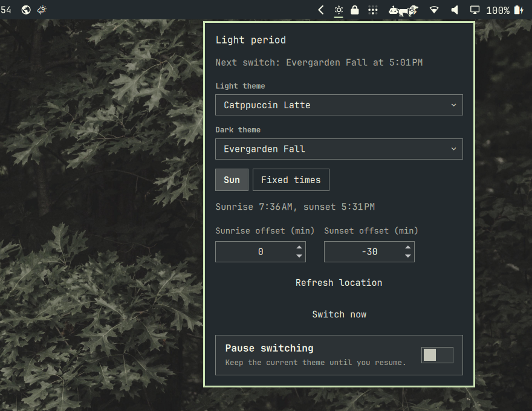
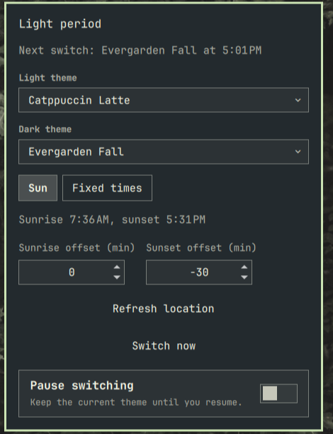

# Daylight

An [Omarchy](https://omarchy.org) shell plugin that switches between a light
and a dark theme at sunrise and sunset, or at times you choose.





## Install

```
omarchy plugin add https://github.com/tomas-nicolorich/omarchy-daylight --enable
```

Remove it with `omarchy plugin remove tomas.daylight`.

Daylight adds a sun or moon icon to the bar (sun in the light period, moon in
the dark period). Click it to open the panel. Choose a light theme and a dark
theme there; switching starts once both are set.

## Settings

Set everything from the panel. Daylight stores the values in its entry in
`~/.config/omarchy/shell.json`, so you can also edit them there.

| Setting | Values | Default | What it does |
| --- | --- | --- | --- |
| `lightTheme` | an installed theme name | unset | Theme for the light period. |
| `darkTheme` | an installed theme name | unset | Theme for the dark period. |
| `mode` | `sun` or `fixed` | `sun` | `sun` follows sunrise and sunset at your location. `fixed` uses `lightTime` and `darkTime`. |
| `sunriseOffsetMinutes` | -180 to 180 | `0` | Shifts the switch to the light theme. Positive is later. Sun mode only. |
| `sunsetOffsetMinutes` | -180 to 180 | `0` | Shifts the switch to the dark theme. Positive is later. Sun mode only. |
| `lightTime` | `HH:MM`, 24 hours | `07:00` | When the light period starts. Fixed mode only. |
| `darkTime` | `HH:MM`, 24 hours | `19:00` | When the dark period starts. A time after midnight is fine. Fixed mode only. |
| `paused` | `true` or `false` | `false` | Keeps the current theme until you resume. The bar icon shows the paused state. |

The panel also has **Switch now**, which applies the other period's theme
immediately. Daylight treats it as a manual change and does not touch the theme
again until the next sunrise or sunset (or the next fixed time).

## How it switches

- Daylight applies a theme only when a switch time passes. Between switch times
  it never changes the theme, so a theme you pick by hand stays until the next
  one.
- Editing a setting or the location never switches the theme. Only the passing
  of time crosses a switch time.
- After sleep or a long shell restart, Daylight applies the current period's
  theme once. It notices a resume within about a minute and re-checks at least
  every 5 minutes.
- If Daylight cannot read the list of installed themes, it skips the switch
  quietly and tries again at the next check.
- If a chosen theme is no longer installed, Daylight sends a notification and
  skips the switch.

## Bar background

Double-clicking the bar cycles its background between clear, glassy and
opaque. Daylight remembers the background you leave on the bar in each period
and restores it when that period's theme comes back, whichever way the theme
changed (a switch time, **Switch now**, or the theme menu). It stores the two
backgrounds in its state file. A theme that is neither the light nor the dark
theme leaves the bar alone.

## Location

Sun mode needs your location, and Daylight calculates sunrise and sunset on
your machine.

1. If you have set a weather location (coordinates in
   `~/.local/state/omarchy/settings/weather.json`), Daylight uses it.
2. Otherwise Daylight makes one request to `https://geo.omarchy.org/`, the same
   endpoint Omarchy's weather widget uses to detect your location. It saves the
   answer in its state file together with the time zone you were in.
3. If neither gives a location, sun mode falls back to the fixed times, and the
   panel says so.

Daylight asks `geo.omarchy.org` again in only two cases: when your time zone
changes (Daylight keeps using the saved location until the new answer arrives),
and when you press **Refresh location** in the panel. That button appears only
when the location comes from this lookup; with coordinates in `weather.json`
there is nothing to refresh. A failed request is not retried for a day, unless
the time zone changes or you press the button.

These requests are the only network calls Daylight makes. Set a weather
location in Omarchy and Daylight makes none.

Changing the location, like changing any setting, never switches the theme by
itself. Daylight moves its bookmark to the current sunrise or sunset and waits
for the next one to pass.

## Files

Daylight writes one file of its own, `~/.local/state/omarchy/daylight-state.json`
(the last switch it acted on, the saved location and the bar background for
each period). Its settings live in
`shell.json`. Removing the plugin leaves nothing else behind; delete the state
file and the `tomas.daylight` entry in `shell.json` to clear those too.

## Tests

```
node --test test/
```

## License

MIT. See `LICENSE`.
